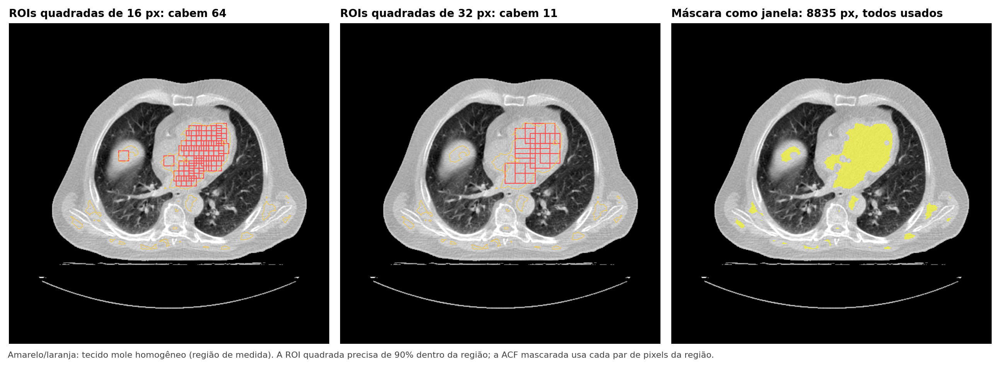
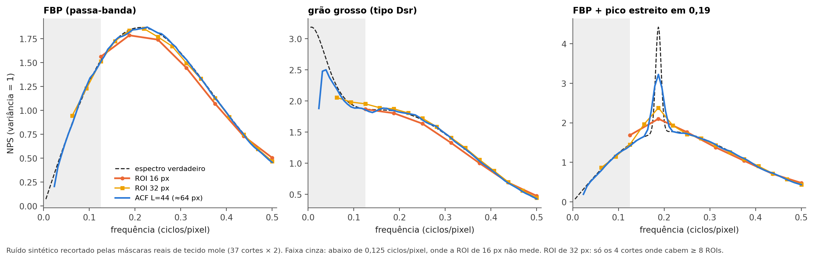
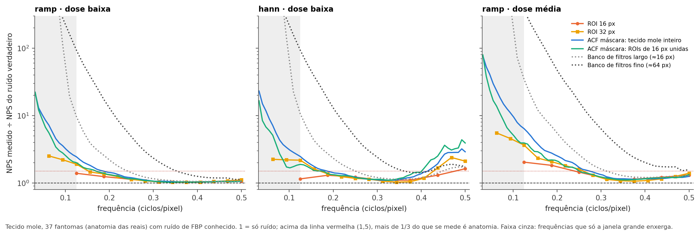
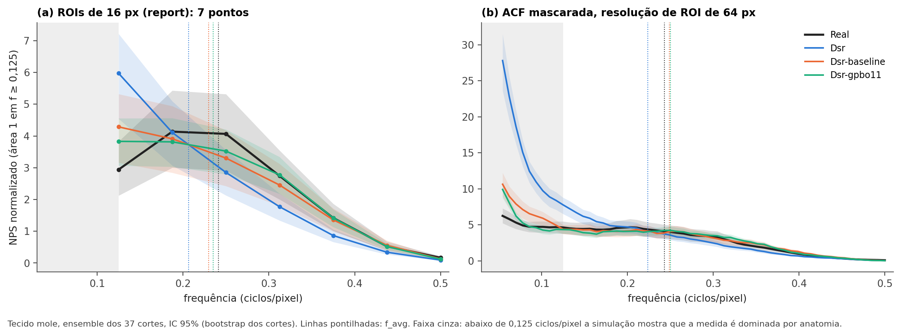

# O tamanho da ROI no NPS: dá para medir com "ROI grande" onde ela não cabe?

**Data:** 12/11/2026 · **Dados:** 37 cortes válidos (`Dsr`, `Dsr-baseline`, `Dsr-gpbo11`; reais idênticas) · **Código:** `frameworks/noise_signature/nps_mascara.py` e `experimentos/nps_tamanho_roi.py`

## A pergunta

No último report, os professores da Penn apontaram que ROIs de 16 px são pequenas demais para o NPS. A ideia a testar: fazer com o NPS o que fizemos com o wavelet (aplicar na imagem inteira e olhar só dentro da região).

## Resposta curta

1. **Do jeito literal do wavelet, não dá.** O coeficiente de Fourier não tem posição, então não existe "olhar só dentro da ROI" depois da transformada. A versão que existe (filtrar a imagem inteira em bandas e medir a potência dentro da máscara) deixa a anatomia de fora da região entrar na medida: erro de 10× a 94× em 0,125 ciclos/pixel.
2. **Existe a versão certa da mesma ideia: a máscara entra antes da transformada.** Calcula-se a autocorrelação só com pares de pixels que estão os dois dentro da região, e o NPS é a transformada dela (Wiener–Khinchin). A ROI não precisa "caber". Dá a resolução de uma ROI de 64 px nos 37 cortes.
3. **Mas a janela maior não traz informação confiável de ruído nas frequências baixas.** Abaixo de ~0,125 ciclos/pixel, mais da metade do que se mede numa imagem de paciente é anatomia (55% a 90%, conforme o método e a frequência), inclusive com a ROI de 32 px onde ela cabe. Isso é limite de imagem única, não de tamanho de ROI.
4. **O que se ganha de verdade:** todos os cortes medidos, resolução de frequência 4× melhor, picos estreitos visíveis, nenhuma escolha de ROI e, na comparação pareada, a faixa baixa (0,047–0,125) passa a ser visível. É nela que o Dsr mais difere da real (2,9× mais energia).
5. **Achado colateral que corrige o report de 05/11:** o teste de vazamento, feito só na real, favorecia a real. O "grão um pouco mais grosso" do baseline e do gpbo11 era esse viés. O grão grosso do Dsr continua valendo, mas com tamanho menor (f_avg −8%, não −15%).

## 1. Onde está o aperto

| ROIs que cabem (≥ 90% na região) | 16 px | 24 px | 32 px | 48 px | 64 px |
|---|---|---|---|---|---|
| **Tecido mole:** cortes com ≥ 8 ROIs | 35/37 | 25/37 | **4/37** | 0/37 | 0/37 |
| **Pulmão:** cortes com ≥ 8 ROIs | 37/37 | 37/37 | 37/37 | 28/37 | **0/37** |

- No tecido mole a região é fina e picada (mediana de 16 pedaços por corte; o maior quadrado que cabe tem 24 px).
- No pulmão cabem ROIs de 32 px em todos os cortes; o que não cabe é 64 px (o tamanho do TG-233).



**Figura 1.** O corte com mais espaço no tecido mole. A ROI quadrada só usa o miolo da região; a máscara como janela usa todos os pixels.

## 2. Os estimadores testados

| Estimador | Como funciona | Resolução |
|---|---|---|
| ROI quadrada (atual) | plano + Hann + \|DFT\|² em ROIs de 16/24/32 px | 1/16 a 1/32 ciclos/pixel |
| **ACF mascarada** | autocovariância só entre pares de pixels da máscara (por FFT; Padfield 2012), em blocos de 64 px com plano ajustado nos pixels da máscara; NPS = DFT da autocovariância × janela de lag de raio L (Blackman–Tukey) | ~1/L: L = 44 ≈ ROI de 64 px |
| Periodograma mascarado | blocos de 64 px, janela = máscara × Hann, normalizado por Σw² | ~1/64, borrado pelo formato da máscara |
| Banco de filtros (análogo do wavelet) | filtra a imagem inteira em bandas radiais, potência média dentro da máscara | à escolha |

A ACF mascarada é o periodograma mascarado com a correção exata do formato da máscara: divide, lag a lag, pelo número de pares que a máscara oferece.

## 3. Teste de geometria: ruído de espectro conhecido nas máscaras reais

Ruído sintético (3 espectros) recortado pelas 37 máscaras reais de tecido mole. Aqui não há anatomia: o teste isola o efeito do formato da região.



**Figura 2.** A ACF mascarada segue o espectro verdadeiro até ~0,03 ciclos/pixel e enxerga o pico estreito.

| | ROI 16 px | ROI 32 px | ACF mascarada L = 44 |
|---|---|---|---|
| Cortes medidos | 33/37 | 4/37 | **37/37** |
| Largura do bin (ciclos/pixel) | 0,0625 | 0,031 | 0,008 |
| Erro de f_avg (3 espectros) | +0,6% a +1,7% | 0% a +0,5% | **0,0%** |
| Desvio padrão de f_avg por corte | 0,0038–0,0046 | 0,0026–0,0042 | **0,0020–0,0023** |
| Pico estreito: fração da altura recuperada | 13% | 26% | **59%** |

- Com a mesma resolução, a ACF mascarada empata com a ROI quadrada (L = 11 ≈ ROI de 16 px; L = 22 ≈ ROI de 32 px). O ganho vem de poder escolher L = 44.
- Tirar a tendência com média local gaussiana (em vez do plano por bloco) corta 2,5% a 4,7% da faixa baixa. Ficou o plano por bloco.

## 4. Teste de anatomia: tomógrafos simulados com ruído conhecido

Os 37 fantomas das reais, 3 máquinas (FBP), ruído verdadeiro conhecido. Em cada frequência: NPS medido ÷ NPS do ruído verdadeiro (1 = só ruído).



**Figura 3.** Tecido mole. Abaixo de 0,125 ciclos/pixel tudo sobe: é anatomia.

| Medido ÷ verdadeiro (ramp, dose baixa: σ ≈ 0,057, como as reais) | 0,06 | 0,09 | 0,125 | 0,19 | 0,25 | 0,375 |
|---|---|---|---|---|---|---|
| ROI 16 px | | | 1,39 | 1,25 | 1,13 | 1,04 |
| ROI 32 px (onde cabe) | 2,5 | 2,2 | 1,91 | 1,37 | 1,13 | 1,03 |
| ACF mascarada, tecido mole inteiro | 7,2 | 3,6 | 2,45 | 1,50 | 1,20 | 1,04 |
| Banco de filtros largo (≈ 16 px) | 6100 | 114 | 9,7 | 2,6 | 1,4 | 1,06 |
| Banco de filtros fino (≈ 64 px) | 975 | 280 | 94 | 17 | 4,9 | 1,4 |
| Pulmão, ROI 32 px | 287 | 292 | 119 | 17 | 3,2 | 1,1 |
| Pulmão, ACF mascarada sem vasos | 143 | 57 | 28 | 6,8 | 2,3 | 1,3 |

- **Frequências baixas são anatomia.** O ruído de FBP tem pouca energia perto de zero; qualquer resto de anatomia domina. Vale para a ROI de 32 px também.
- **Banco de filtros (jeito do wavelet) não serve.** Banda estreita tem resposta larga no espaço, e as bordas de fora da região entram. No wavelet de textura isso não aparece porque as escalas finas têm filtros curtos.
- **A ACF mascarada pega mais anatomia que a ROI de 16 px em 0,125–0,25** (usa todos os pixels, não só os mais calmos). No f_avg: −6,7% contra −3,2%. Na comparação pareada isso se cancela (próximo item).
- **Pulmão:** a máscara sem vasos melhora, mas continua longe (28× em 0,125). O problema do pulmão é a textura do parênquima, não o tamanho da ROI. Confirma `resultados/ruido_pulmao_viabilidade`.

### O viés de escolher as ROIs na própria imagem

Mesma anatomia, **outra realização do mesmo ruído** (uma sintética perfeita), medida nas ROIs escolhidas na primeira imagem:

| 2ª realização ÷ 1ª | f_avg | C_texture | energia em 0,125 |
|---|---|---|---|
| ROI 16 px com teste de vazamento (report) | **0,974** | 0,067 | **+27%** |
| ACF mascarada, tecido mole inteiro | 1,001 | 0,020 | −4% |
| ACF mascarada, só os 20% mais homogêneos | 0,964 | 0,119 | +19% |

- O teste de vazamento descarta as ROIs em que o primeiro bin é o maior. Isso também descarta ROIs em que o **ruído** calhou de ser alto ali. A imagem que escolhe sai com menos energia em 0,125; a outra, não.
- Uma sintética perfeita teria f_avg sint ÷ real = 0,974 e C_texture = 0,067 no método do report.
- Medir só nos pixels mais homogêneos (`strict`) tem o mesmo defeito, mais forte. Por isso a ACF mascarada usa a região inteira (`host`), que é definida por faixa de intensidade da imagem suavizada.

## 5. Dados reais



**Figura 4.** O mesmo ensemble nos dois métodos. À direita, a faixa cinza (abaixo de 0,125) é a que a ROI de 16 px não vê.

| Ensemble, sint ÷ real (IC 95%) | Dsr | Dsr-baseline | Dsr-gpbo11 |
|---|---|---|---|
| f_avg, ROI 16 px (report) | 0,855 (0,84–0,87) | 0,953 (0,94–0,97) | 0,974 (0,96–0,99) |
| **f_avg, ACF mascarada** | **0,919 (0,91–0,93)** | 1,023 (1,01–1,04) | 1,028 (1,02–1,04) |
| σ na faixa ≥ 0,125, ACF mascarada | 0,87 (0,79–0,96) | 0,88 (0,80–0,98) | 0,94 (0,85–1,05) |
| C_texture, ACF mascarada | 0,22 (0,19–0,26) | 0,08 (0,06–0,11) | 0,10 (0,08–0,13) |
| **Energia em 0,047–0,125 ÷ energia ≥ 0,125** | **2,94 (2,56–3,33)** | 1,39 (1,17–1,63) | 1,13 (0,95–1,29) |

Quem escolhe as ROIs muda a resposta (f_avg sint ÷ real, ensemble):

| Variante | Dsr | Dsr-baseline | Dsr-gpbo11 |
|---|---|---|---|
| ROI 16 px, vazamento testado na real (report) | 0,855 | 0,953 | 0,974 |
| ROI 16 px, sem teste de vazamento | 0,883 | 0,988 | 1,010 |
| ROI 16 px, vazamento testado nas duas imagens | 0,923 | 1,006 | 1,012 |
| ACF mascarada, região da real | 0,919 | 1,023 | 1,028 |
| ACF mascarada, interseção das regiões da real e da sintética | 0,925 | 1,026 | 1,037 |

Por corte (ACF mascarada, 37 cortes; controle real × real vizinho: 0,93–1,05):

| | Dsr | Dsr-baseline | Dsr-gpbo11 |
|---|---|---|---|
| f_avg sint ÷ real: mediana | 0,929 | 1,031 | 1,030 |
| cortes abaixo de 1 | 28/37 | 7/37 | 4/37 |
| cortes fora da faixa do controle | 23/37 | 13/37 | 13/37 |

O que fica de pé e o que muda em relação ao report de 05/11:

- **Dsr tem grão mais grosso: confirmado** por um método independente e sem escolha de ROI. O tamanho do efeito na faixa ≥ 0,125 cai para −7% a −8% (era −15%). A diferença maior está na faixa baixa, que a ROI de 16 px não via: 2,9× mais energia que a real.
- **Baseline e gpbo11 não têm grão mais grosso que a real.** Ficam iguais ou até 2–4% mais finos na faixa ≥ 0,125. O "pouco de energia a mais na frequência mais baixa" do report era o viés do teste de vazamento.
- **Baseline ainda tem mais energia na faixa baixa** (1,39×); no gpbo11 a diferença não é clara (1,13×, IC inclui 1).
- **Quantidade de ruído:** mesma direção do report (sintéticas com 6% a 13% menos ruído).
- **Cuidado com a faixa baixa:** ela é dominada por anatomia. Como real e sintética são medidas nos mesmos pixels, um excesso na sintética é diferença real entre as imagens, mas não dá para dizer se é ruído de baixa frequência ou anatomia alterada pelo gerador.

## 6. Recomendação

1. **Trocar o NPS de ROIs de 16 px pela ACF mascarada (L = 44) no tecido mole inteiro.** Resolve a crítica do tamanho da ROI, mede os 37 cortes e não escolhe ROIs.
2. **Reportar em duas faixas:** ≥ 0,125 ciclos/pixel como "ruído" (σ, f_avg, C_texture) e 0,047–0,125 só como razão pareada sintética ÷ real, com o aviso de anatomia.
3. **Manter a ROI de 16 px como conferência, sem o teste de vazamento** (ou com o teste nas duas imagens).
4. **Corrigir o report de 05/11** nos pontos da seção 5.
5. **Não usar f_pico:** a anatomia faz a curva subir para a esquerda e o pico cai na borda da faixa.
6. **Pulmão:** continua não viável; tamanho de ROI não é o problema.
7. **Para medir ruído de verdade abaixo de 0,125** é preciso tirar a anatomia: duas aquisições do mesmo corte ou fantoma do mesmo tomógrafo. Vale perguntar à Penn se existe.

## Limitações

- A simulação usa FBP paralelo e fantomas feitos das próprias reais; o tamanho exato do viés (0,974) vale para aquele regime de ruído.
- A resolução de 64 px supõe ruído estacionário dentro de cada bloco de 64 px.
- Um tomógrafo, 3 pacientes, 37 cortes; o bootstrap dos cortes não corrige a dependência dentro do paciente.
- Anisotropia do NPS 2D não foi avaliada (a ACF mascarada tem menos pares nas direções em que a região é fina).

## Literatura

- **TG-233** (Samei et al., 2019): meta de ~100 ROIs de 64 × 64 px.
- **Dolly et al., 2016** (JACMP 17(3)): testou ROIs de 32 a 128 px; o erro do NPS cai com o tamanho da ROI; com 32 px o resultado depende da remoção de fundo, sobretudo nas frequências baixas.
- **Goto et al., 2014** (RSNA, pôster PHS132): a superestimativa das frequências baixas piora com ROI menor; a janela quase não ajuda com ROI ≤ 32 px; propõem deconvolução.
- **Padfield, 2012** (IEEE TIP 21(5)): correlação por FFT com máscara, base do cálculo da ACF mascarada.
- **Blackman & Tukey, 1958**: espectro pela transformada da autocovariância com janela de lag.
- Encontrados e **não lidos** (acesso falhou): Narita et al., 2023 (Radiol Phys Technol; NPS que não depende do tamanho da ROI) e Walek & Jan (NPS em regiões segmentadas irregulares, com janela adaptativa).

---

*Tabelas (`tamanhos.csv`, `geometria.csv`, `anatomia.csv`, `anatomia_metricas.csv`, `selecao_de_rois.csv`, `real_ensemble.csv`, `real_quem_escolhe.csv`, `real_por_corte.csv`, `controle_vizinhos.csv`) e figuras geradas com (semente 20261112, ~2 min):*

```bash
.venv/bin/python -m frameworks.noise_signature.experimentos.nps_tamanho_roi --output-dir resultados/ruido_tamanho_roi
```
