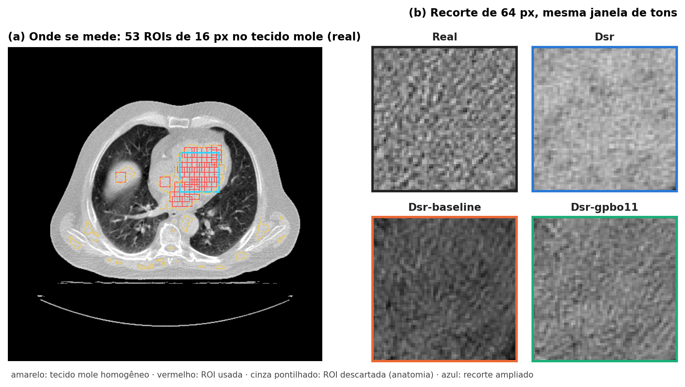
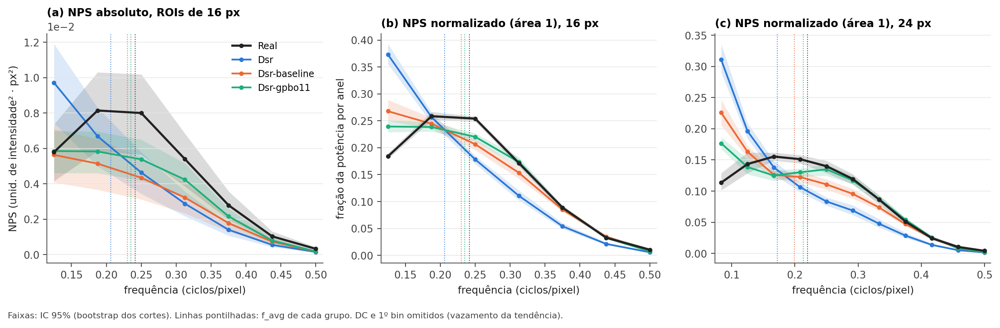
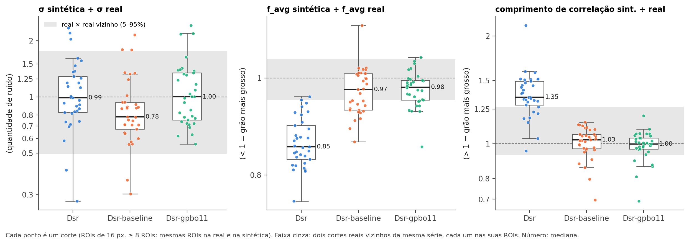
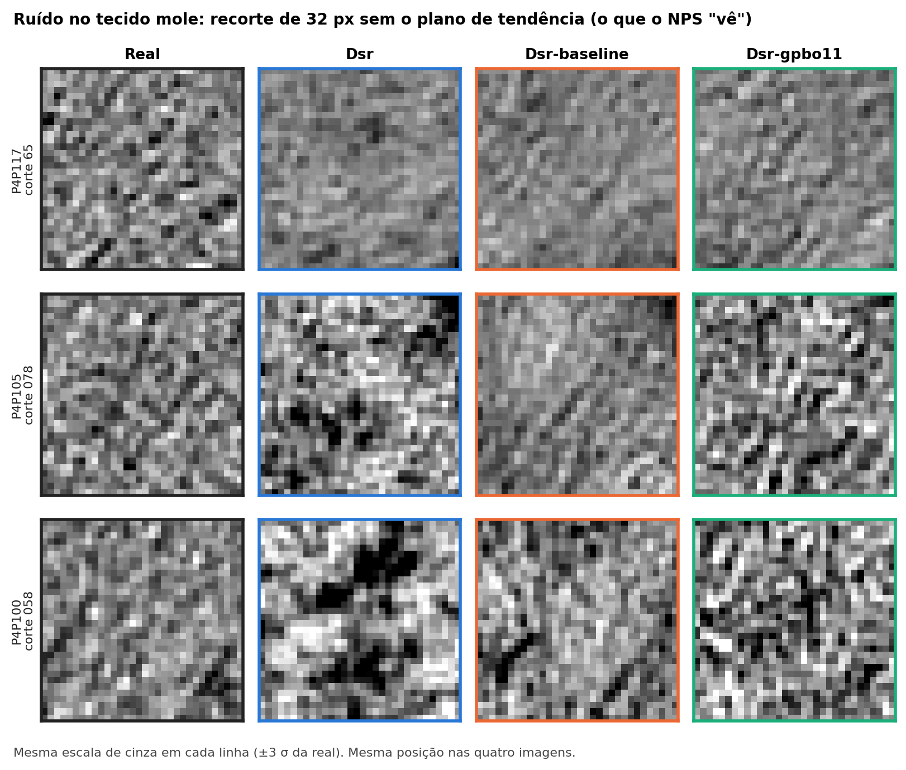

# Ruído no tecido mole: espectro de potência do ruído (NPS)

**Data:** 05/11/2026 · **Conjuntos:** `Dsr`, `Dsr-baseline`, `Dsr-gpbo11` (mesma anatomia; as reais são idênticas nos três) · **Cortes:** 37 válidos (P4P117 = 25, P4P105 = 11, P4P100 = 1)

## Papel

Esta seção responde a uma pergunta só: **o ruído da CT sintética se parece com o ruído da CT real?** Ela olha duas coisas, como no relatório AAPM TG-233 (Samei et al., 2019):
- **quantidade de ruído:** o desvio padrão σ;
- **textura do ruído (o "grão"):** a forma do NPS, que diz se o grão é fino (energia em frequências altas) ou grosso (energia em frequências baixas). Resumimos a forma pela frequência média `f_avg` e pelo comprimento de correlação (a distância, em pixels, em que o grão deixa de se parecer consigo mesmo).

**Por que no tecido mole e não no pulmão.** A literatura de medida de ruído em imagem de paciente é clara:
- no **parênquima pulmonar**, a anatomia (vasos, septos) vaza para a medida e o σ sai cerca de **+50%** acima do ruído verdadeiro; no **ar**, sai cerca de **−50%**; em **tecido mole homogêneo**, o erro fica em poucos por cento (+3% a +4% em FBP) (Ria et al., 2023, simulação XCAT/DukeSim);
- os métodos automáticos validados medem no tecido mole ou no fígado (Christianson et al., 2015; Smith et al., 2021).

A análise do pulmão está em estudo à parte. Esta seção é a parte **inicial e mais segura** da análise de ruído.

## Como a medida é feita

1. **Região:** tecido mole fora do pulmão (mediastino, coração, parede), na faixa de intensidade do pico de tecido mole da própria real, sem bordas, e só os pixels mais homogêneos (os 20% com menor energia do tensor de estrutura). Função `soft_region` do framework `noise_signature`.
2. **ROIs:** quadrados de **16 px**, com ≥ 90% dentro da região e sobreposição ≤ 50%. Descartamos as ROIs cujo NPS cresce para a frequência zero, sinal de anatomia dentro da ROI (o ruído de FBP é passa-banda; Friedman et al., 2013).
   - As ROIs são escolhidas **na real** e aplicadas **iguais** à sintética. Assim real e sintética são medidas nos mesmos pixels (Baek & Pelc, 2010).
3. **NPS de cada ROI (Dolly et al., 2016):** subtrai o plano de 1ª ordem, aplica janela de Hann e tira |DFT|². O perfil radial dá o NPS em função da frequência. O DC e o 1º anel são ignorados.
4. **NPS de ensemble:** somamos as ROIs de **todos os cortes** de cada grupo (real, Dsr, baseline, gpbo11), como recomenda o TG-233. São **1027 ROIs** de 16 px nos 37 cortes, bem acima das ~30 ROIs que Dolly et al. pedem para erro < 5%.
5. **Normalização da forma:** dividimos o NPS pela sua área (Solomon et al., 2012; Oostveen et al., 2024), para comparar a forma sem a quantidade. A diferença de forma é `C_texture = ∫|nNPS_sint − nNPS_real|` (Oostveen et al., 2024).
6. **Incerteza:** IC 95% por bootstrap **dos cortes** (2000 sorteios; as ROIs de um corte andam juntas), pareado entre real e sintética.
7. **Tamanho da ROI:** 16 px é o que cabe no tecido mole destas imagens. Com 24 px a resolução de frequência melhora 1,5×, mas sobram 261 ROIs em 33 cortes; com 32 px, só 86 ROIs em 22 cortes (inviável). Usamos **16 px como principal e 24 px como confirmação**.



**Figura 1.** (a) Um corte real (P4P117, corte 65) com as 53 ROIs de 16 px usadas no tecido mole. (b) O mesmo recorte de 64 px nas quatro imagens, na mesma janela de tons.
- Na real o grão é fino e uniforme. No Dsr o grão é visivelmente mais "manchado".

## Achados

### 1. A real tem o NPS típico de CT; o Dsr desloca a energia para frequências baixas



**Figura 2.** NPS de ensemble (1027 ROIs de 16 px; 261 ROIs de 24 px), com faixa de IC 95%.
- **Real:** NPS **passa-banda**, com pico em torno de 0,19–0,25 ciclos/pixel e queda até Nyquist. É a forma esperada de uma reconstrução FBP (Friedman et al., 2013).
- **Dsr:** a curva normalizada **cai desde a frequência mais baixa**. Sobra energia no grão grosso e falta no fino.
- **Baseline e gpbo11:** muito mais perto da real. O gpbo11 é o mais próximo, mas os dois ainda têm um pouco de energia a mais na frequência mais baixa.
- O resultado é o mesmo com ROIs de 24 px (painel c).

| Ensemble, 16 px (IC 95%) | Real | Dsr | Dsr-baseline | Dsr-gpbo11 |
|---|---|---|---|---|
| σ (unid. de intensidade) | 0,057 (0,048–0,064) | 0,051 (0,045–0,057) | 0,046 (0,039–0,052) | 0,050 (0,044–0,055) |
| **σ sint ÷ σ real** | | 0,91 (0,82–1,01) | **0,82 (0,74–0,91)** | 0,88 (0,80–0,99) |
| f_avg (ciclos/pixel) | 0,241 (0,239–0,244) | 0,206 (0,203–0,211) | 0,230 (0,226–0,234) | 0,235 (0,233–0,238) |
| **f_avg sint ÷ real** | | **0,85 (0,84–0,87)** | 0,95 (0,93–0,97) | 0,97 (0,96–0,99) |
| **comprimento de correlação sint ÷ real** | | **1,40 (1,33–1,46)** | 1,04 (1,01–1,07) | 1,01 (0,98–1,03) |
| C_texture (forma; 0 = igual) | | 0,38 (0,35–0,42) | 0,17 (0,14–0,22) | 0,11 (0,10–0,14) |

Com 24 px: f_avg sint ÷ real = 0,78 (0,75–0,81) no Dsr, 0,91 (0,87–0,94) no baseline e 0,97 (0,94–1,00) no gpbo11.

**Qual é a variação natural?** Dividindo as reais ao acaso em duas metades e comparando os dois ensembles (2000 vezes), a razão de f_avg fica entre 0,98 e 1,02, o comprimento de correlação entre 0,97 e 1,03 e o C_texture entre 0,01 e 0,05. O deslocamento do Dsr está muito fora disso. O C_texture dos três conjuntos também passa desse limite.

### 2. Corte a corte: o grão grosso do Dsr aparece em quase todos os cortes; a quantidade varia muito



**Figura 3.** Razão sintética ÷ real em cada corte (33 cortes com ≥ 8 ROIs de 16 px), nas mesmas ROIs. Faixa cinza: dois cortes **reais** vizinhos da mesma série, cada um nas suas próprias ROIs (29 pares; 5–95%).

| Por corte, 16 px | Dsr | Dsr-baseline | Dsr-gpbo11 | Real × real vizinho (5–95%) |
|---|---|---|---|---|
| f_avg: mediana (IC 95%) | **0,85 (0,84–0,87)** | 0,97 (0,94–1,00) | 0,98 (0,96–0,99) | 0,95–1,04 |
| f_avg: cortes < 1 · fora da faixa real | **33/33 · 31/33** | 22/33 · 16/33 | 27/33 · 9/33 | |
| f_avg: Wilcoxon (razão = 1) | p < 0,001 | p = 0,003 | p < 0,001 | |
| comprimento de correlação: mediana | **1,35 (1,31–1,45)** | 1,03 (0,99–1,05) | 1,00 (0,98–1,02) | 0,93–1,27 |
| σ: mediana (IC 95%) | 0,99 (0,84–1,19) | **0,78 (0,71–0,91)** | 1,00 (0,79–1,31) | 0,50–1,76 |
| σ: Wilcoxon (razão = 1) | p = 0,87 | **p = 0,014** | p = 0,86 | |

- **O grão grosso do Dsr é sistemático:** f_avg menor que o da real em **todos os 33 cortes**, e 31 deles fora da faixa de dois cortes reais vizinhos.
- **O baseline tem menos ruído:** σ 22% menor na mediana dos cortes (25 de 33 cortes abaixo da real). É o mesmo sinal já visto no framework de 4 eixos (`t1_soft_sigma_ratio`, `resultados/ruido_datasets`).
- **No Dsr e no gpbo11 o σ não tem viés claro por corte**, mas espalha muito (de ~0,3× a ~2,4×). No ensemble os dois saem ~10% abaixo da real. A diferença entre ensemble e mediana vem dos cortes com mais ruído, que pesam mais no ensemble.
- **Ordem de grandeza perceptual:** o deslocamento do Dsr (0,035 ciclos/pixel em f_avg) é da ordem do limiar de percepção de textura de Oostveen et al. (2024), cerca de 0,03 ciclos/pixel com pixel de ~0,75 mm. O do gpbo11 (0,006) fica bem abaixo. É só uma referência: o limiar foi medido em fantoma, e não sabemos o tamanho do pixel.

### 3. Baseline × gpbo11

| | gpbo11 − baseline (ensemble, IC 95%) | Por corte: gpbo11 mais perto da real | Wilcoxon |
|---|---|---|---|
| razão de σ | +0,06 (0,03 a 0,11): mais perto de 1 | 20 de 33 | p = 0,29 |
| razão de f_avg | +0,02 (0,01 a 0,03): mais perto de 1 | 19 de 33 | p = 0,24 |
| razão do comprimento de correlação | −0,04 (−0,06 a −0,01): mais perto de 1 | 20 de 33 | p = 0,18 |
| C_texture | −0,06 (−0,09 a −0,01): forma mais parecida | | |

- **Na coorte, o gpbo11 é melhor que o baseline nas quatro medidas.** Corte a corte, a vantagem ainda não é significativa com 16 px. Com 24 px ela é significativa no comprimento de correlação (12 de 17 cortes; p = 0,017).

## A medida é confiável?

- **Simulação de tomógrafos** (`resultados/ruido_simulacao`): as originais viraram fantomas, e reconstruímos 12 "máquinas" (4 kernels × 3 doses) com ruído conhecido. O NPS do tecido mole recupera o ruído verdadeiro:
  - **com ruído forte** (dose baixa, σ verdadeiro 0,021–0,056): σ com erro de **+5% a +11%** e f_avg com erro de **−1% a −3%**;
  - **com pouco ruído** o σ é superestimado (+62% a +157% na dose alta), porque a anatomia residual passa a pesar.
  - Nossas reais têm σ ≈ 0,057 e as sintéticas 0,046–0,051, na **mesma escala de intensidade** da simulação: estamos no regime de ruído forte, onde a medida é boa.
  - Como real e sintética são medidas **nas mesmas ROIs**, o viés comum se cancela em boa parte nas razões.
- **Controle real × real:** dois cortes reais vizinhos da mesma série diferem pouco no grão (f_avg 0,95–1,04) e muito na quantidade (σ 0,50–1,76). Por isso o achado de **grão** é forte e o de **quantidade** por corte é fraco.

## O que isso significa

- **O ruído do Dsr tem o grão errado:** mais grosso e "manchado" que o da CT real, em praticamente todos os cortes, com a quantidade de ruído parecida (Figura 4).
- **O baseline corrige quase todo o grão, mas tem menos ruído que a real** (~20% a menos).
- **O gpbo11 é o mais próximo da real** no grão e na quantidade. Ainda sobra um pouco de energia nas frequências mais baixas.



**Figura 4.** Recorte de 32 px do tecido mole, sem o plano de tendência, em três pacientes. Mesma escala de cinza em cada linha. São exemplos ilustrativos, e alguns recortes ainda têm um pouco de anatomia.

## Limitações

- **Sem HU e sem tamanho de pixel:** as frequências estão em ciclos/pixel e o σ em unidades da imagem normalizada. Não dá para comparar em valor absoluto com tabelas de tomógrafos.
- **Poucos dados:** um tomógrafo, 3 pacientes, 37 cortes (25 de um só paciente). O bootstrap dos cortes não corrige a dependência entre cortes do mesmo paciente.
- **ROIs pequenas:** 16 px dão bins de frequência largos (0,0625 ciclos/pixel). Por isso **não usamos o f_peak** (ele só pula de bin em bin) e o f_avg por corte é impreciso: a repetibilidade de `t1_soft_f_avg` nas reais é ruim (1,12; `resultados/ruido_simulacao`). Os achados principais são **de coorte**. Os de corte valem só quando o efeito é grande, como no Dsr.
- **Cobertura:** 4 cortes do P4P105 têm menos de 8 ROIs e ficam fora das razões por corte, mas entram no ensemble. É o mesmo problema dos 2 cortes sem tecido mole no framework de 4 eixos.
- **Imagem única:** sem duas aquisições para subtrair, as frequências mais baixas carregam um pouco de anatomia (Dolly et al., 2016). Isso afeta a real e a sintética igualmente, nas mesmas ROIs.
- **Controle real × real** usa cortes vizinhos com ROIs diferentes. É uma régua generosa, maior que a variação de uma nova realização do ruído no mesmo corte.

## Próximos passos

- **Pulmão:** viabilidade em estudo à parte, com a remoção de vasos e o cuidado com o viés de +50%.
- Mais pacientes e um teste perceptual simples para dizer se a diferença de grão do Dsr é visível.

## Referências

- Samei E, et al. *Performance Evaluation of CT Systems*, AAPM Report 233, 2019.
- Dolly S, et al. *Practical considerations for noise power spectra estimation for clinical CT scanners*. JACMP 17(3), 2016.
- Friedman SN, et al. *A simple approach to measure CT MTF and NPS using the ACR phantom*. Med Phys 40(5), 2013.
- Oostveen LJ, et al. *Perceptual thresholds for differences in CT noise texture*. J Med Imaging 11(3), 2024.
- Solomon J, Christianson O, Samei E. *Quantitative comparison of noise texture across CT scanners*. Med Phys 39(10), 2012.
- Ria F, et al. *Accuracy of noise magnitude measurements from patient CT images: a virtual imaging study*. Duke, 2023.
- Christianson O, et al. *Automated technique to measure noise in clinical CT examinations*. AJR 205, 2015.
- Smith TB, et al. *Automated methodology to assess perceptual in vivo noise texture in liver CT*. J Med Imaging 8(5), 2021.
- Baek J, Pelc NJ. *The noise power spectrum in CT with direct fan beam reconstruction*. Med Phys 37(5), 2010.

---

*Figuras, tabelas (`ensemble.csv`, `razoes_por_corte.csv`, `por_corte.csv`, `nps_ensemble.csv`, `controle_vizinhos.csv`) e `resumo.json` gerados com (semente 20261105, ~10 s):*

```bash
.venv/bin/python -m frameworks.noise_signature.experimentos.nps_tecido_mole --output-dir resultados/ruido_tecido_mole
```

*Números da simulação citados de `resultados/ruido_simulacao/acuracia_sigma_nps.csv` (copiados em `simulacao_citada.csv`).*
